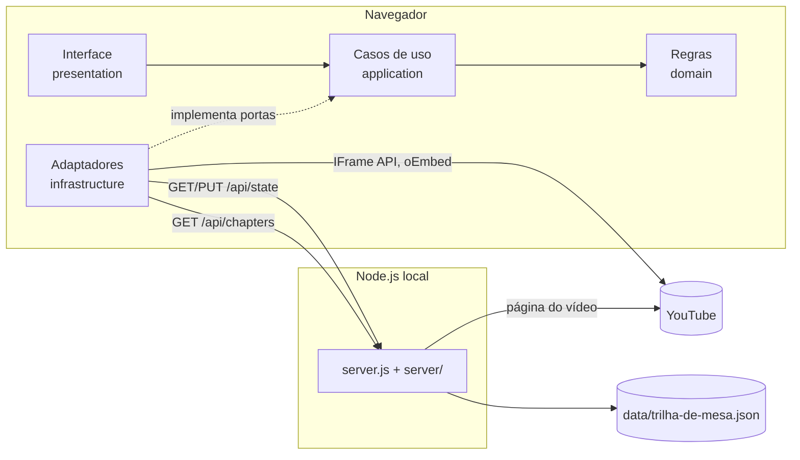
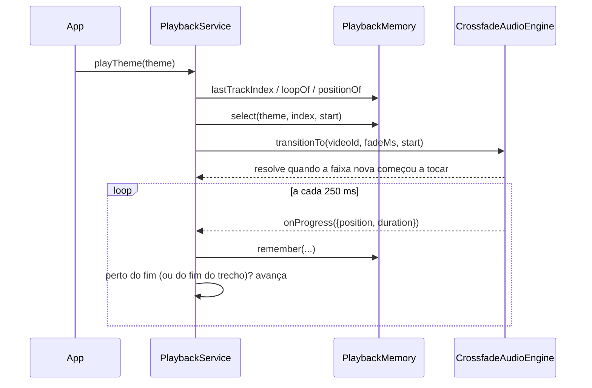
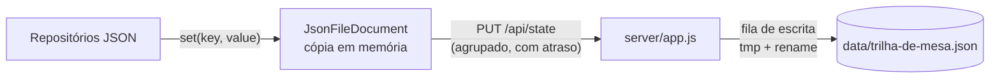

# Arquitetura

Este documento explica como o Trilha de Mesa é organizado por dentro: as camadas, quem fala com quem e como as principais funcionalidades (crossfade, loops, retomada e salvamento) funcionam.

- Para rodar e testar o projeto, veja [DESENVOLVIMENTO.md](DESENVOLVIMENTO.md).
- Para a API HTTP e o formato do arquivo de dados, veja [API.md](API.md).

## Visão geral

O app tem duas partes que rodam na máquina do usuário:



- **Servidor (Node, sem dependências):** entrega os arquivos de `public/`, guarda o estado num único JSON e busca os capítulos dos vídeos. Ele existe porque o navegador sozinho não grava em disco e não pode ler a página do YouTube (CORS).
- **Cliente (JavaScript puro, ES modules, sem build):** toda a lógica de reprodução. O áudio sai de players do YouTube embutidos e escondidos.

## Camadas (Clean Architecture)

As dependências sempre apontam para dentro. `domain` não importa nada; `application` só importa `domain`; `infrastructure` e `presentation` conhecem `application` e `domain`, mas nunca se conhecem diretamente. Só `main.js` conhece todo mundo.

```
public/src
├── domain/            Regras puras, sem I/O
│   ├── YouTubeLink.js   Value object: valida e extrai videoId/playlistId de um link
│   ├── Theme.js         Criação/renomeação de temas e faixas
│   ├── Loop.js          Tipos de loop (nenhum, faixa, trecho) e validação
│   └── errors.js        Hierarquia de erros de domínio
├── application/       Casos de uso; não conhecem YouTube, DOM nem fetch
│   ├── ports.js         Contratos (JSDoc) que a infraestrutura implementa
│   ├── ThemeLibrary.js  Adicionar, renomear, remover/desfazer, buscar títulos
│   ├── PlaybackService.js  Máquina de estados da reprodução
│   ├── PlaybackMemory.js   Faixa, segundo e loop de cada tema
│   ├── ChapterCatalog.js   Cache de capítulos por vídeo
│   └── concurrency.js   mapWithConcurrency (limita requisições paralelas)
├── infrastructure/    Detalhes concretos
│   ├── youtube/         Players, crossfade, oEmbed, playlist, capítulos
│   └── storage/         Documento JSON sincronizado com o servidor
├── presentation/      Interface (DOM puro, sem framework)
│   ├── App.js           Controlador: liga eventos aos casos de uso e redesenha
│   ├── ThemeCard.js, NowPlayingBar.js, LoopPanel.js, AddThemeForm.js, Toasts.js
│   └── dom.js, icons.js, format.js   Helpers
└── main.js            Raiz de composição: instancia e injeta as dependências
```

### Portas e adaptadores

| Porta (`ports.js`)         | Implementação                         | Função                                    |
| -------------------------- | ------------------------------------- | ----------------------------------------- |
| `AudioEngine`              | `CrossfadeAudioEngine`                | Tocar, pausar e trocar faixas com fade    |
| `ThemeRepository`          | `JsonThemeRepository`                 | Lista de temas                            |
| `SettingsRepository`       | `JsonSettingsRepository`              | Volume e tempo de transição               |
| `PlaybackMemoryRepository` | `JsonPlaybackMemoryRepository`        | Posições e loops por tema                 |
| `MetadataGateway`          | `OEmbedMetadataGateway`               | Títulos de vídeos e playlists             |
| `PlaylistGateway`          | `YouTubePlaylistResolver`             | IDs dos vídeos de uma playlist            |
| `ChapterGateway`           | `ServerChapterGateway`                | Capítulos via `/api/chapters`             |

Para trocar uma peça (por exemplo, salvar num banco de dados), implemente a porta e mude só o `main.js`. Os testes usam implementações falsas dessas mesmas portas.

## Modelo de dados

```js
Theme  = { id, name, kind: 'video' | 'playlist', tracks: Track[], createdAt }
Track  = { videoId, title }          // title pode ser '' até o oEmbed responder
Loop   = { type: 'none' }
       | { type: 'track' }
       | { type: 'section', start, end | null, label }   // segundos; end null = até o fim
```

Os temas são imutáveis do ponto de vista do código: `ThemeLibrary` sempre lê a lista do repositório, gera uma lista nova e salva tudo de volta.

## Reprodução (`PlaybackService`)

O serviço é uma máquina de estados pequena. O estado público é:

```js
{ status: 'idle' | 'playing' | 'paused', loading, themeId, trackIndex, loop, volume, crossfadeSeconds, notice }
```

A interface assina mudanças com `subscribe()` e o progresso com `subscribeProgress()`.

### Fluxo de uma troca de faixa



Regras importantes:

- **Requisições concorrentes:** cada transição recebe um `requestId`. Se o usuário trocar de faixa antes da anterior terminar de carregar, o resultado da antiga é ignorado.
- **Avanço antecipado:** a próxima faixa começa `crossfadeSeconds + 2 s` antes do fim da atual. Os 2 segundos extras dão tempo para o YouTube carregar o vídeo novo. Em faixas curtas, a antecedência é limitada à metade da duração.
- **Loop:** `none` avança na playlist (vídeo único repete a si mesmo); `track` repete a faixa; `section` volta ao `start` do trecho ao chegar no `end`.
- **Falhas:** `TrackUnavailableError` (vídeo bloqueado para incorporação, tempo esgotado) pula para a próxima faixa até ter tentado todas. Qualquer outro erro para a reprodução e mostra um aviso.

### Retomada (`PlaybackMemory`)

- Guarda, por tema: a última faixa tocada, o segundo de cada faixa e o loop escolhido para cada faixa.
- Ao voltar para um tema, ele retoma na faixa e no segundo salvos. Trocar de faixa (botão ou avanço automático) começa do zero, ou do início do trecho se houver um loop de trecho.
- Se faltavam menos de 20 s para acabar, a faixa recomeça do zero na próxima vez.
- Ao iniciar, `retainOnly()` descarta os dados de temas que já foram removidos.

## Crossfade (`CrossfadeAudioEngine`)

- Dois `YT.Player` (os "decks") ficam escondidos em `#player-host`. Um toca enquanto o outro espera.
- Numa transição, o deck ocioso é silenciado, carrega o vídeo novo com ganho 0 e, quando ele começa a tocar, os ganhos são animados com **curva de potência igual**: `cos(t·π/2)` para quem sai e `sin(t·π/2)` para quem entra. A soma das potências fica constante, então o volume percebido não afunda no meio da transição.
- O volume final de cada deck é `master × gain`, em porcentagem.
- Cada animação recebe um token (`#fadeToken`). Uma transição nova invalida a anterior, que para no meio sem estragar os ganhos.
- A animação usa `setTimeout` a cada 50 ms. Com a aba em segundo plano, o navegador limita os timers e o fade fica menos suave. Isso é uma limitação conhecida.

## Persistência



- `JsonFileDocument` carrega o JSON inteiro uma vez (`GET /api/state`). As leituras seguintes são síncronas, direto da memória.
- As gravações são agrupadas: 300 ms para temas e configurações, 3 s para posições (que mudam o tempo todo). Também há envio ao ocultar a aba (`visibilitychange`) e ao fechá-la (`pagehide`, com `keepalive` se o corpo couber em 60 KB).
- Se um envio falhar, ele é repetido a cada 5 s e a interface mostra um aviso (no máximo um a cada 30 s).
- **Proteção contra perda de dados:** se a leitura inicial falhar, `canSave` fica `false` e nada é enviado. Assim um estado vazio nunca sobrescreve o arquivo real.
- No servidor, as gravações passam por uma fila (uma de cada vez). Cada uma escreve num `.tmp` e faz `rename`, que é atômico. No Windows, o `rename` é repetido algumas vezes se o arquivo estiver bloqueado por antivírus ou indexador. Uma gravação que falha não bloqueia as seguintes.
- `migrateLegacyStorage` copia para o arquivo, uma única vez, os temas de versões antigas que salvavam no `localStorage`.

## Integração com o YouTube (sem chave de API)

| Necessidade          | Como é feito                                                                 |
| -------------------- | ---------------------------------------------------------------------------- |
| Tocar áudio          | IFrame Player API (`loadYouTubeApi.js`, `YouTubeDeck.js`)                    |
| Listar uma playlist  | Player temporário com `listType: 'playlist'` e leitura de `getPlaylist()`    |
| Títulos              | Endpoint público `youtube.com/oembed`                                        |
| Capítulos            | O servidor baixa a página do vídeo e lê `chapterRenderer` ou, se não houver, os tempos escritos na descrição (`server/chapters.js`) |

Limitações conhecidas:

- `getPlaylist()` do player costuma devolver no máximo cerca de 200 vídeos.
- Mixes automáticos (`list=RD...`) não podem ser listados e são tratados como vídeo único.
- A leitura de capítulos depende do HTML do YouTube. Se o formato mudar, os capítulos deixam de aparecer, mas o resto do app continua funcionando.
- Vídeos com a incorporação desativada pelo dono não tocam; o app pula para a próxima faixa.

## Segurança

- O servidor escuta apenas em `127.0.0.1` por padrão. Com `HOST=0.0.0.0` ele fica acessível na rede local, e o terminal mostra um aviso.
- Rotas `/api/*` só aceitam `Host` local (`localhost`, `127.0.0.1`, `[::1]`), o que protege contra DNS rebinding. Essa checagem é desligada quando `HOST` não é local.
- Arquivos estáticos: o caminho é normalizado e precisa ficar dentro de `public/`. URLs malformadas e bytes nulos devolvem 400.
- Corpo de `PUT` limitado a 5 MB (devolve 413).
- A interface monta o DOM com `h()` (`textContent` e atributos), nunca com `innerHTML` a partir de dados do usuário. A única exceção é `icons.js`, com SVGs estáticos.
